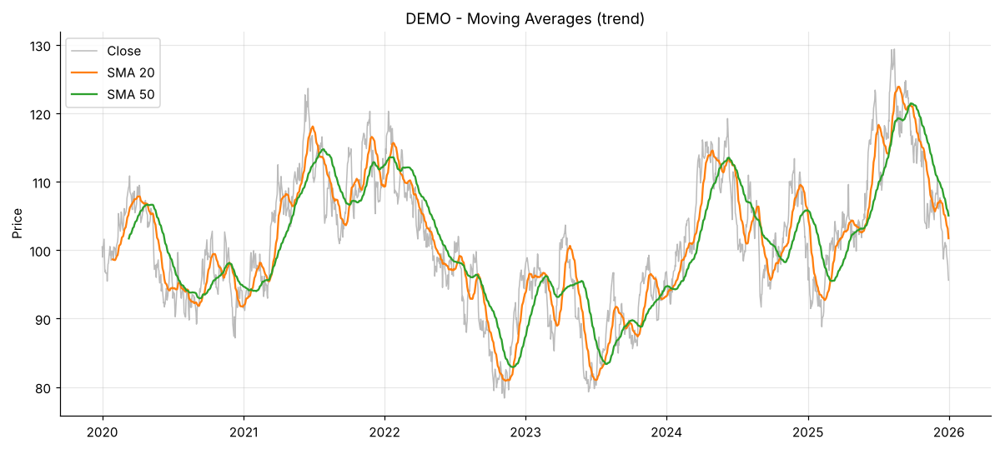
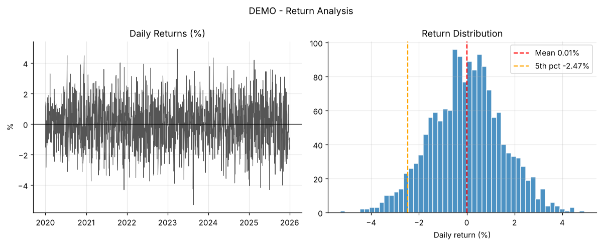
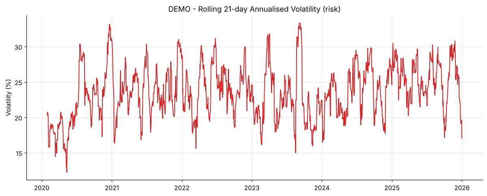
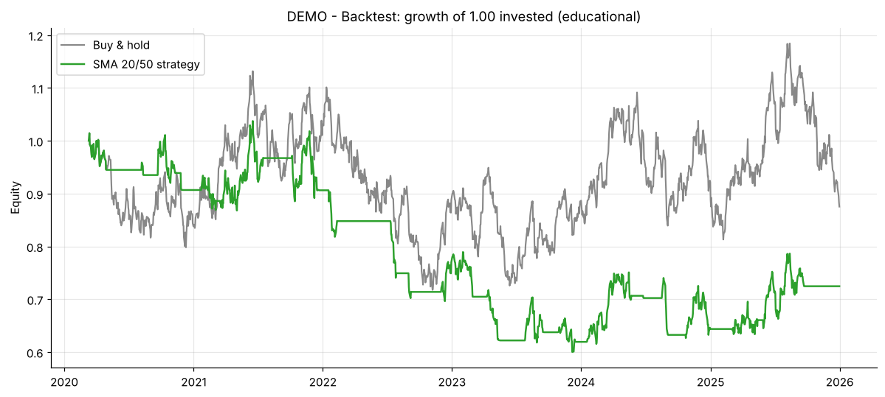

# 📈 Stock Market Data Analyzer

A beginner-friendly, modular Python project that **fetches stock data, cleans it, computes returns, moving averages, volatility and technical indicators, backtests an SMA-crossover strategy, and produces charts plus a written report** - with an optional Streamlit dashboard.

> ⚠️ **Disclaimer:** Educational project only. Historical data and backtests do not predict future results. **This is not financial advice.**

---

## 1. Problem Statement
Checking price history by hand is slow and error-prone. Analysts, traders and finance teams need a repeatable way to answer: *What is the trend? How risky is it? How did it perform? What would a simple rule-based strategy have done?*

## 2. Industry Relevance
Brokerages, fintechs, research desks and quant teams all run the same pipeline in larger form: **ingest → clean → feature engineering (indicators) → backtest → report/dashboard**. This project demonstrates each of those stages at student scale.

## 3. Features
- Data from **Yahoo Finance (yfinance)** → **CSV fallback** → **offline synthetic demo data** (the project always runs)
- Cleaning: column standardisation, duplicate removal, missing-value handling, bad-price removal, OHLC consistency fix
- Daily & log returns, cumulative return
- SMA / EMA, RSI, MACD, Bollinger Bands, rolling volatility, drawdown
- Risk metrics: annualised volatility, Sharpe ratio, max drawdown, historical 95% VaR
- Highest / lowest close, best / worst day, SMA crossover dates, trend label
- Long-only **SMA crossover backtest** with transaction costs, **no look-ahead bias**, vs buy & hold
- 8 charts saved as PNG, Markdown report, JSON summary, processed CSV
- Streamlit dashboard, unit tests (11)

## 4. Tech Stack
Python 3.10+ · Pandas · NumPy · Matplotlib · yfinance · Streamlit (optional) · unittest

## 5. Folder Structure
```
Stock-Market-Data-Analyzer/
├── data/            # sample_stock.csv (synthetic demo) + your own CSVs
├── notebooks/       # exploration notebooks (optional)
├── src/             # config, data_loader, cleaning, indicators, analysis, backtest, visualize, report
├── tests/           # unit tests
├── outputs/         # processed CSV / JSON / backtest CSV (git-ignored)
├── images/          # saved charts
├── reports/         # generated Markdown reports
├── docs/            # architecture, GitHub steps, proof plan, interview prep
├── app.py           # Streamlit dashboard
├── main.py          # command-line entry point
├── requirements.txt
└── README.md
```

## 6. How to Run
```bash
git clone https://github.com/arppitha-ai/Stock-Market-Data-Analyzer.git
cd Stock-Market-Data-Analyzer
python3 -m venv venv && source venv/bin/activate      # Windows: venv\Scripts\activate
pip install -r requirements.txt

python main.py                                         # AAPL via Yahoo Finance (falls back automatically)
python main.py --ticker TCS.NS --start 2021-01-01      # Indian stock
python main.py --source csv --csv data/sample_stock.csv --ticker DEMO
python main.py --source sample                         # fully offline

streamlit run app.py                                   # dashboard
python -m unittest discover -s tests -v                # tests
```

## 7. Sample Output
> The numbers below come from the **synthetic demo dataset** (`data/sample_stock.csv`), not a real company. Run with a real ticker to get real results.

```
 Period               : 2020-01-01 -> 2025-12-31
 Total return         : -4.87%
 Annualised volatility: 23.87%  (Moderate risk)
 Sharpe ratio         : -0.03
 Max drawdown         : -36.60%
 Current trend        : Downtrend
 SMA 20/50 backtest   : Strategy -27.54% | 21 trades | win rate 33%   vs   Buy&Hold -12.48%
```
Full report: [`reports/DEMO_report.md`](reports/DEMO_report.md)

## 8. Screenshots
| Moving averages | Returns |
|---|---|
|  |  |

| Volatility | Backtest |
|---|---|
|  |  |

*(Replace with screenshots of a real ticker such as AAPL once you run it with internet.)*

## 9. Learning Outcomes
Time-series handling in Pandas · data cleaning · return/risk maths · technical indicators · vectorised backtesting and look-ahead bias · modular code design · testing · reporting and dashboards · Git/GitHub workflow.

## 10. Future Improvements
SQLite/Parquet storage · FastAPI service · alerts (RSI/Bollinger) · portfolio P&L · walk-forward testing · multi-stock comparison · Docker.

## 11. Disclaimer
This project is for **educational purposes only** and is **not financial advice**. Do not make investment decisions based on it.
