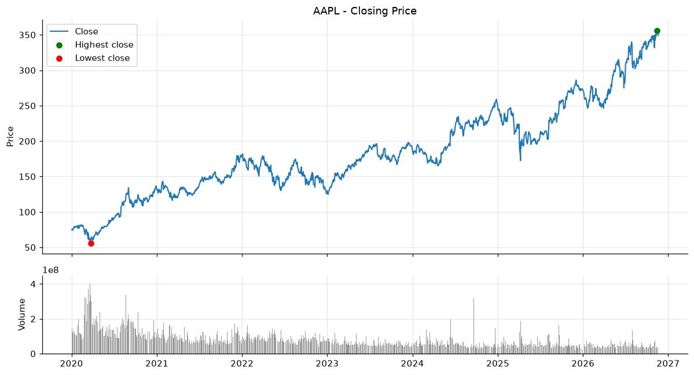
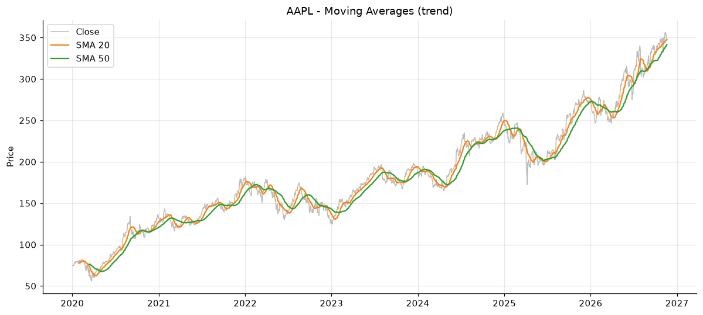
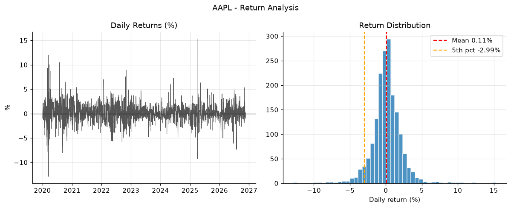
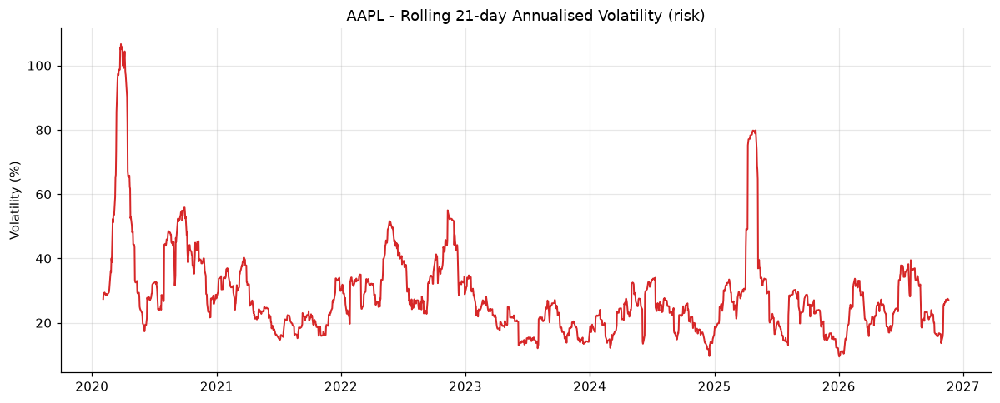
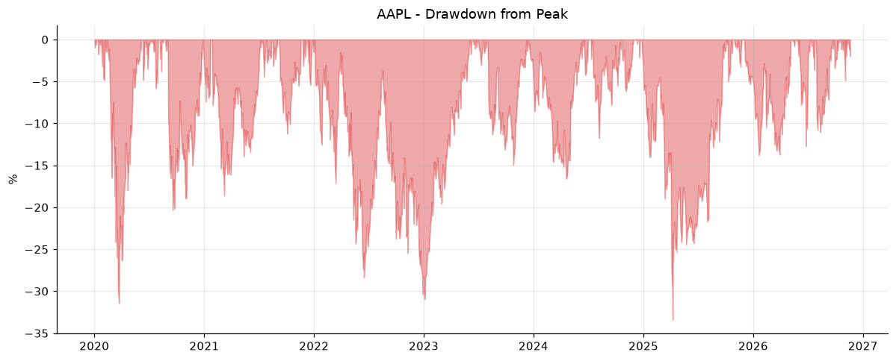
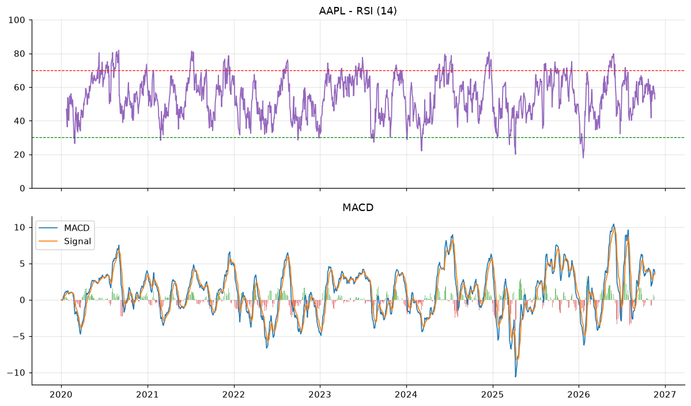
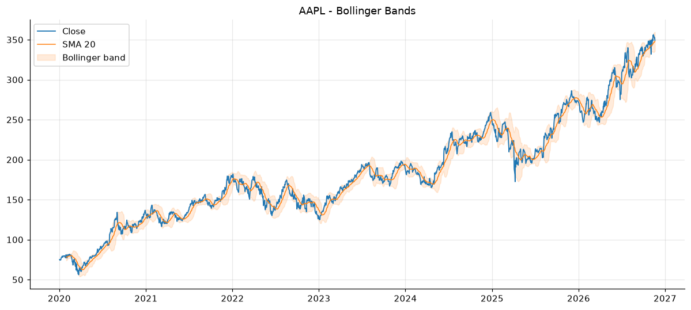
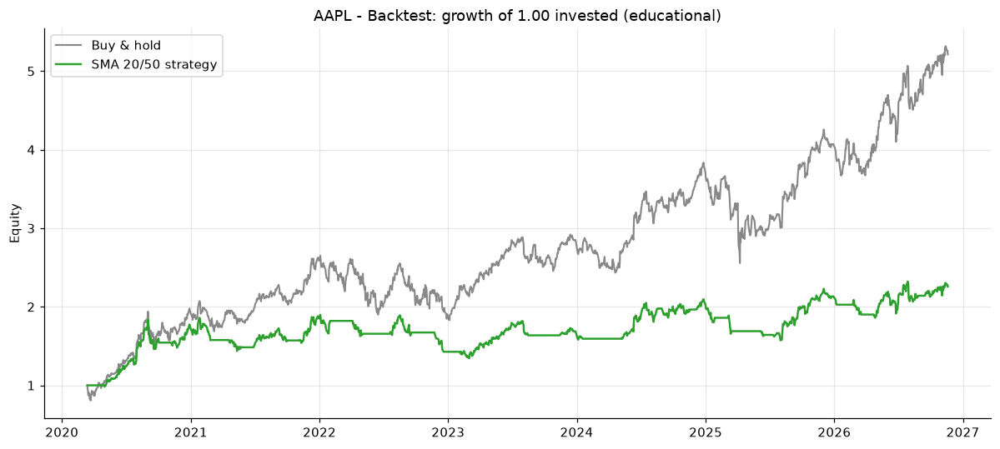

# Stock Analysis Report - AAPL

> Educational project only. Historical data and backtests do not predict future results. This is NOT financial advice.

- **Data source:** Yahoo Finance (yfinance)
- **Period:** 2020-01-02 to 2026-11-19 (1731 trading days)
- **Rows cleaned:** 1731 raw -> 1731 clean (0 duplicates removed)

## Key Insights

- AAPL moved from 72.22 to 349.21 (+383.6%) between 2020-01-02 and 2026-11-19, about +25.7% per year.
- Annualised volatility is 31.1%, a moderate-risk profile by this project's simple scale.
- The deepest peak-to-trough fall (max drawdown) was -33.4%.
- On a typical bad day (historical 95% VaR) the stock fell about 3.0% or more on roughly 1 day in 20.
- Best day: +15.3% on 2025-04-09; worst day: -12.9% on 2020-03-16.
- Highest close 356.27 (2026-11-13); lowest close 56.09 (2020-03-23).
- Current trend by the SMA rules: Uptrend.
- Latest RSI is 53.0, which is neutral (30-70).

## Performance & Risk Summary

| Metric | Value |
|---|---|
| Total return | 383.56% |
| Annualised return | 25.74% |
| Annualised volatility | 31.11% (Moderate risk) |
| Sharpe ratio (rf = 0) | 0.83 |
| Max drawdown | -33.36% |
| 1-day 95% VaR (historical) | -2.99% |
| Positive days | 53.01% |
| Highest close | 356.27 on 2026-11-13 |
| Lowest close | 56.09 on 2020-03-23 |

## Backtest: SMA 20/50 Crossover (long-only, 5 bps fee)

| Metric | Strategy | Buy & Hold |
|---|---|---|
| Total return | 125.71% | 421.25% |
| Annualised return | 12.97% | 28.06% |
| Annualised volatility | 20.73% | 29.92% |
| Sharpe ratio | 0.63 | 0.94 |
| Max drawdown | -29.15% | -33.36% |
| Trades | 21 | - |
| Win rate (per trade) | 47.62% | - |
| Time in market | 61.47% | 100% |

## Latest SMA Crossovers

| Date | Close | Signal |
|---|---|---|
| 2026-04-23 | 273.43 | BUY (bullish cross) |
| 2026-07-07 | 310.66 | SELL (bearish cross) |
| 2026-07-09 | 316.22 | BUY (bullish cross) |
| 2026-08-26 | 313.45 | SELL (bearish cross) |
| 2026-09-15 | 331.34 | BUY (bullish cross) |

## Charts

---
*Educational project only. Historical data and backtests do not predict future results. This is NOT financial advice.*
