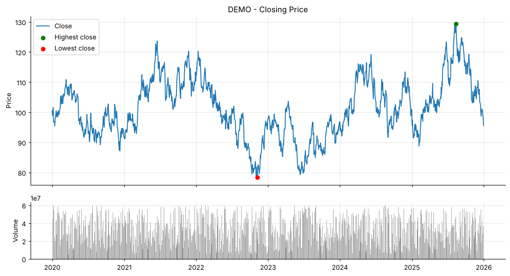
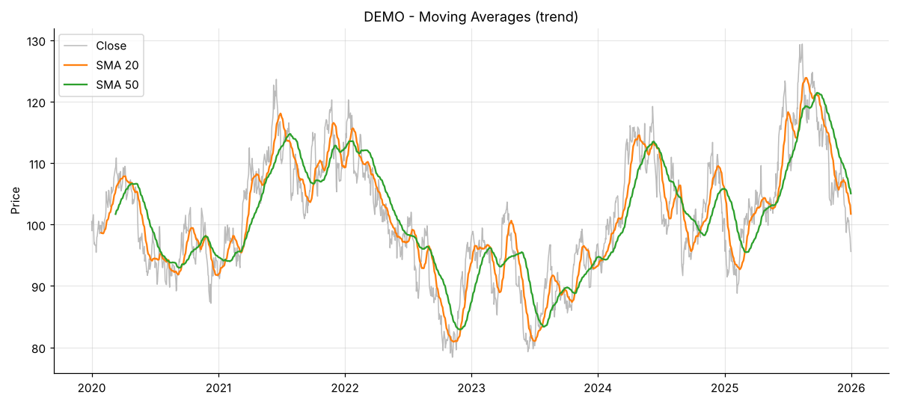
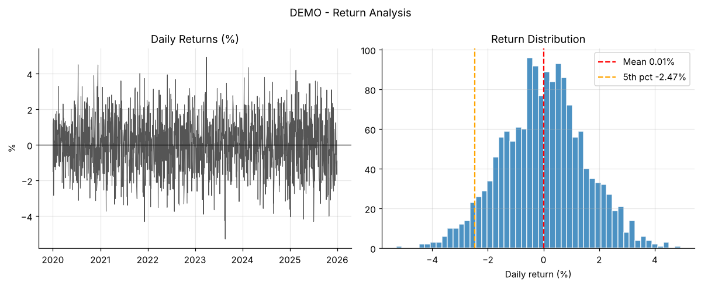
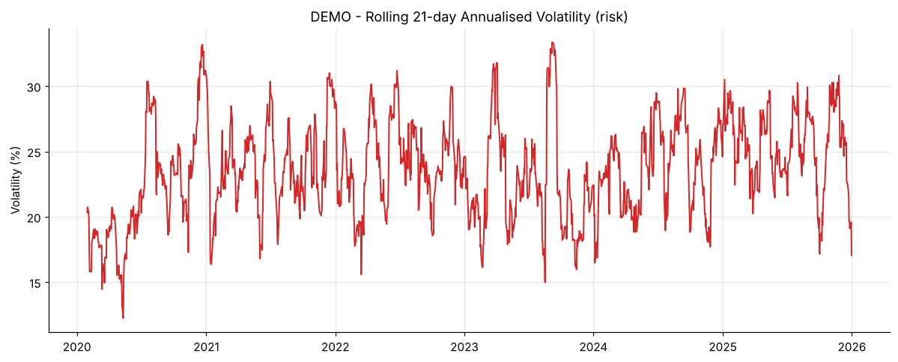
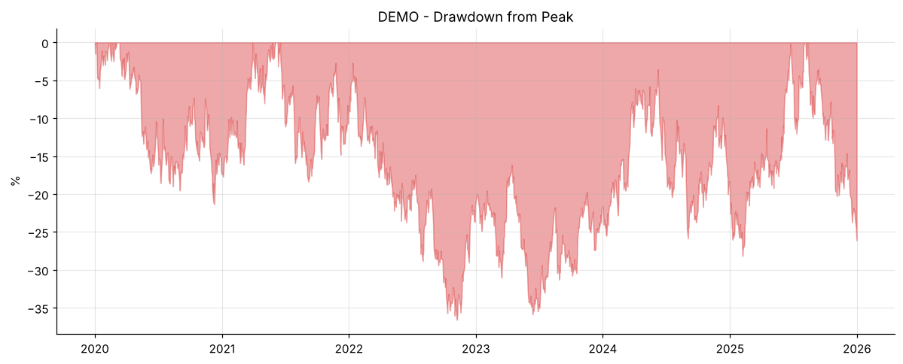
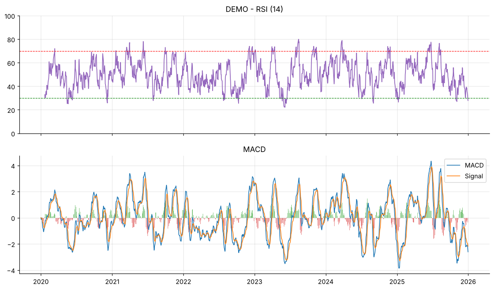
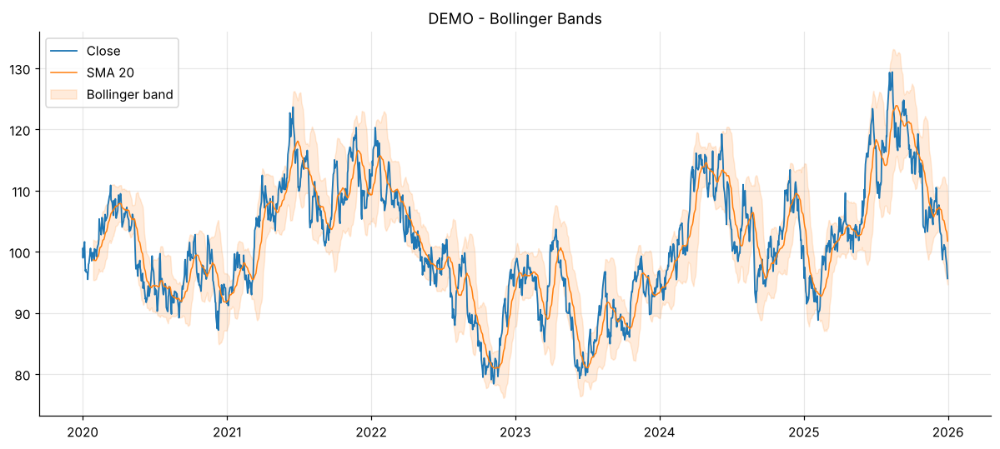
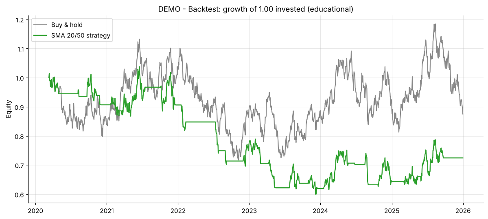

# Stock Analysis Report - DEMO

> Educational project only. Historical data and backtests do not predict future results. This is NOT financial advice.

- **Data source:** CSV file (sample_stock.csv)
- **Period:** 2020-01-01 to 2025-12-31 (1566 trading days)
- **Rows cleaned:** 1566 raw -> 1566 clean (0 duplicates removed)

## Key Insights

- DEMO moved from 100.50 to 95.61 (-4.9%) between 2020-01-01 and 2025-12-31, about -0.8% per year.
- Annualised volatility is 23.9%, a moderate-risk profile by this project's simple scale.
- The deepest peak-to-trough fall (max drawdown) was -36.6%.
- On a typical bad day (historical 95% VaR) the stock fell about 2.5% or more on roughly 1 day in 20.
- Best day: +4.9% on 2023-03-30; worst day: -5.3% on 2023-08-22.
- Highest close 129.38 (2025-08-13); lowest close 78.39 (2022-11-07).
- Current trend by the SMA rules: Downtrend.
- Latest RSI is 27.8, which is oversold (<30).

## Performance & Risk Summary

| Metric | Value |
|---|---|
| Total return | -4.87% |
| Annualised return | -0.83% |
| Annualised volatility | 23.87% (Moderate risk) |
| Sharpe ratio (rf = 0) | -0.03 |
| Max drawdown | -36.60% |
| 1-day 95% VaR (historical) | -2.47% |
| Positive days | 50.80% |
| Highest close | 129.38 on 2025-08-13 |
| Lowest close | 78.39 on 2022-11-07 |

## Backtest: SMA 20/50 Crossover (long-only, 5 bps fee)

| Metric | Strategy | Buy & Hold |
|---|---|---|
| Total return | -27.54% | -12.48% |
| Annualised return | -5.21% | -2.19% |
| Annualised volatility | 16.53% | 24.01% |
| Sharpe ratio | -0.32 | -0.09 |
| Max drawdown | -42.15% | -36.60% |
| Trades | 21 | - |
| Win rate (per trade) | 33.33% | - |
| Time in market | 48.19% | 100% |

## Latest SMA Crossovers

| Date | Close | Signal |
|---|---|---|
| 2025-05-14 | 104.14 | SELL (bearish cross) |
| 2025-05-29 | 108.30 | BUY (bullish cross) |
| 2025-07-31 | 123.04 | SELL (bearish cross) |
| 2025-08-01 | 123.26 | BUY (bullish cross) |
| 2025-09-22 | 119.26 | SELL (bearish cross) |

## Charts

---
*Educational project only. Historical data and backtests do not predict future results. This is NOT financial advice.*
